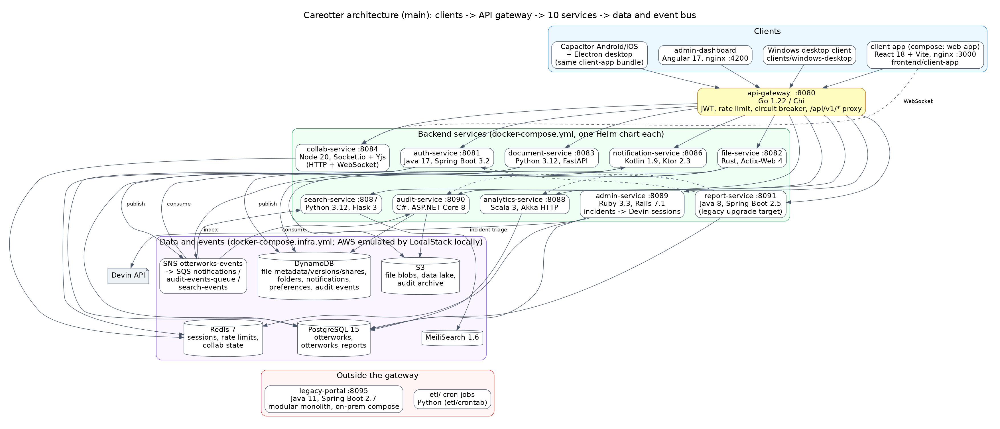

# Careotter Architecture

Careotter is a patient records platform for doctor offices: clinicians store, edit and
share patient charts and clinical documents. It is a polyglot microservices system (a
2026-07-22 rebrand of the OtterWorks workshop app, so service, database, queue and bucket
names still use the `otterworks` prefix). This page describes what the code on `main`
does today. Request-level flows are in [docs/flows.md](docs/flows.md) and the hosted demo
platform (EKS tenants, ops dashboard, reaper) in
[demo-platform/docs/architecture.md](demo-platform/docs/architecture.md).



The diagram source is [`docs/diagrams/architecture.dot`](docs/diagrams/architecture.dot)
(Graphviz). Edit it and run `docs/diagrams/render.sh` to regenerate
`architecture.png` and `architecture.svg`.

## Layers at a glance

| Layer | What runs | Defined in |
|-------|-----------|------------|
| Clients | `client-app` (web, Capacitor Android/iOS, Electron), `admin-dashboard`, Windows desktop client | `frontend/`, `clients/` |
| Edge | `api-gateway` (Go) | `services/api-gateway` |
| Core services | 10 services behind the gateway | `services/*`, `docker-compose.yml` |
| Data and events | PostgreSQL, Redis, MeiliSearch, DynamoDB, S3, SNS/SQS | `docker-compose.infra.yml`, `scripts/localstack-init.sh`, `infrastructure/terraform` |
| Batch | Cron-driven Python ETL jobs | `etl/` |
| Standalone legacy app | `legacy-portal` modular monolith (not behind the gateway) | `services/legacy-portal` |
| Ops | Observability, security config, Helm/Terraform, demo platform | `observability/`, `security/`, `infrastructure/`, `platform/`, `demo-platform/` |

## Clients

| Client | Stack | Notes |
|--------|-------|-------|
| `frontend/client-app` | React 18, TypeScript, Vite, React Router, Tailwind, Zustand, TanStack Query, TipTap | Served by nginx on `:3000` (compose service `web-app`). nginx and the Vite dev server proxy `/api/v1/*` to the gateway (`API_GATEWAY_URL`). The editor opens a WebSocket straight to collab-service (`VITE_COLLAB_WS_URL`; compose builds it as `ws://localhost:8084`). |
| Capacitor Android/iOS, Electron desktop | Same `client-app` bundle | `capacitor.config.ts` + `mobile/`; Electron shell in `desktop/` (`make dev-android`, `make dev-electron`) |
| `frontend/admin-dashboard` | Angular 17, Angular Material | Served on `:4200`; calls `/api/v1/admin/*` and other admin APIs through the gateway. |
| `clients/windows-desktop` | WPF on .NET Framework 4.8 (`OtterWorks.Desktop.sln`) | Native Windows client for the gateway API; builds on Windows only. |

## API gateway

`services/api-gateway` (Go 1.22, Chi) is the single entry point on `:8080`. It
validates JWTs, applies rate limits, wraps each upstream in a circuit breaker, adds
request IDs and CORS, and reverse-proxies by path prefix
(`internal/config/config.go`):

| Prefix | Upstream |
|--------|----------|
| `/api/v1/auth`, `/api/v1/settings` | auth-service |
| `/api/v1/files`, `/api/v1/folders` | file-service |
| `/api/v1/documents`, `/api/v1/templates` | document-service |
| `/api/v1/collab`, `/socket.io` | collab-service |
| `/api/v1/notifications`, `/api/v1/preferences` | notification-service |
| `/api/v1/search` | search-service |
| `/api/v1/analytics` | analytics-service |
| `/api/v1/admin` | admin-service |
| `/api/v1/audit` | audit-service |
| `/api/v1/reports` | report-service |

## Core services

| Service | Port | Stack | Owns |
|---------|------|-------|------|
| auth-service | 8081 | Java 17, Spring Boot 3.2, Gradle | Registration, login, JWT issue/refresh, RBAC, user settings. PostgreSQL (Flyway) + Redis. |
| file-service | 8082 | Rust, Actix-Web 4 | Upload/download, folders, versions, sharing. Blobs in S3, metadata in DynamoDB; publishes file events to SNS. |
| document-service | 8083 | Python 3.12, FastAPI, SQLAlchemy, Alembic | Documents (patient charts), templates, comments, version history. PostgreSQL; publishes document events to SNS. |
| collab-service | 8084 | Node 20, TypeScript, Express, Socket.io, Yjs | Real-time co-editing (CRDT), cursors and presence over HTTP and WebSocket on the same port. Redis for state and fan-out. |
| notification-service | 8086 | Kotlin 1.9, Ktor 2.3 | Consumes the `otterworks-notifications` SQS queue, stores notifications and preferences in DynamoDB, pushes over WebSocket, sends email via SES. |
| search-service | 8087 | Python 3.12, Flask 3 | Full-text search over MeiliSearch; indexes from the `otterworks-search-events` queue. |
| analytics-service | 8088 | Scala 3, Akka HTTP | Usage metrics and dashboards from PostgreSQL; data-lake bucket `otterworks-data-lake`. |
| admin-service | 8089 | Ruby 3.3, Rails 7.1, Sidekiq | Users, quotas, feature flags, announcements, system health, alerts and incidents. Incidents can open Devin triage sessions (`DEVIN_API_KEY`). PostgreSQL + Redis. |
| audit-service | 8090 | C#, ASP.NET Core 8 | Consumes `otterworks-audit-events-queue`; audit log in DynamoDB, archive in S3. |
| report-service | 8091 | Java 8, Spring Boot 2.5, Maven | **Legacy on purpose**: PDF/CSV/Excel reports stored in the `otterworks_reports` database, pulling data from analytics, audit and auth. Upgrade path in [`services/report-service/UPGRADE_GUIDE.md`](services/report-service/UPGRADE_GUIDE.md). |

No compose service listens on 8085.

## Data and events

Locally, `docker-compose.infra.yml` runs PostgreSQL 15, Redis 7 and MeiliSearch 1.6;
LocalStack 3.8 emulates AWS and `scripts/localstack-init.sh` creates:

- **S3**: `otterworks-files`, `otterworks-data-lake`, `otterworks-audit-archive`
- **DynamoDB**: `otterworks-file-metadata`, `-file-versions`, `-file-shares`, `-folders`,
  `-notifications`, `-notification-preferences`, `-audit-events`
- **SNS → SQS**: topic `otterworks-events` fans out to `otterworks-notifications`,
  `otterworks-audit-events-queue` and `otterworks-search-events`

PostgreSQL holds the shared `otterworks` database (auth, documents, admin, analytics) and
`otterworks_reports` (created by `scripts/init-db.sql`). In AWS the same resources come
from `infrastructure/terraform/modules` (`database`, `cache`, `search`, `storage`,
`messaging`, `auth`, `irsa`, `monitoring`). Demo tenants run with SNS/SQS disabled (see
[AGENTS.md](AGENTS.md)).

## Batch ETL

`etl/` holds plain Python jobs run by cron through `etl/run.sh` (schedule in `etl/crontab`):

| Job | Schedule (UTC) |
|-----|----------------|
| `analytics_daily.py` | daily 02:00 |
| `storage_cleanup_daily.py` | daily 02:30 |
| `user_activity_daily.py` | daily 05:00 |
| `audit_archive_weekly.py` | Sunday 03:00 |
| `search_reindex_weekly.py` | Sunday 04:00 |

`etl/ETL_UPGRADE_GUIDE.md` describes the move to an orchestrated pipeline. The
`make batch-usage-rollup` job is documented in [docs/BATCH-USAGE-ROLLUP.md](docs/BATCH-USAGE-ROLLUP.md).

## Legacy portal

[`services/legacy-portal`](services/legacy-portal/README.md) (`:8095`) is a Java 11,
Spring Boot 2.7 modular monolith with three bounded contexts (announcements, user
preferences, feedback), each in its own package and database schema. It is the "before"
state for rehost and decomposition demos: it runs from its own
`docker-compose.onprem.yml` or as a fat JAR under systemd, is not routed by the gateway,
and has no Helm chart or entry in the root `docker-compose.yml` or `ci.yml`.

## Observability

`docker-compose.infra.yml` also runs Prometheus, Grafana (`:3001`), Jaeger, an
OpenTelemetry collector and Fluent Bit, configured from `observability/` (Prometheus
scrape config, alert and recording rules; Grafana provisioning and dashboards; OTel
collector and sampling; Fluent Bit). Services export OTLP traces to the collector and
expose Prometheus metrics. Runbooks are in `docs/runbooks/`.

## Security

| Path | Purpose |
|------|---------|
| `security/scanning` | Trivy config used by `security-scan.yml` |
| `security/policies` | Default-deny, DNS and namespace-egress Kubernetes NetworkPolicies |
| `tests/api` | Cross-service API flow tests (`make test-api-flows`) |

## Deployment

- **Kubernetes**: one Helm chart per deployable in `infrastructure/helm/` (11 backend
  services plus `web-app` and `admin-dashboard`); namespace, quota and limit range in
  `infrastructure/k8s/`. `scripts/deploy-dev.sh` wires config and secrets from Terraform
  outputs.
- **AWS base**: `platform/terraform` (VPC, EKS, ECR) and `infrastructure/terraform`
  (application data stores and IRSA).
- **Demo platform**: `demo-platform/` and `scripts/deploy-tenant.sh` run per-attendee
  tenants on the shared `otterworks-dev` cluster; see its
  [architecture doc](demo-platform/docs/architecture.md).
- **CI/CD** (`.github/workflows`): `ci.yml` (path-filtered build and test per service,
  plus API flow tests), `security-scan.yml`, `sast-auto-remediate.yml` and
  `docker-build.yml` (images on `main` pushes and `v*` tags).

## Repository layout

```
careotter/
├── services/                 # api-gateway + 10 core services + legacy-portal
├── frontend/
│   ├── client-app/           # React + Vite web app (+ Capacitor, Electron)
│   └── admin-dashboard/      # Angular admin console
├── clients/windows-desktop/  # native Windows client
├── etl/                      # cron ETL jobs
├── security/                 # Trivy config, network policies
├── tests/                    # API flow and contract tests
├── testdata/                 # generated test data and harness
├── shared/                   # OpenAPI specs, event schemas, proto notes
├── infrastructure/           # Helm charts, k8s base, app Terraform
├── platform/terraform/       # VPC, EKS, ECR
├── demo-platform/            # multi-tenant demo control plane
├── observability/            # Prometheus, Grafana, Jaeger, OTel collector, Fluent Bit
├── scripts/                  # local init, seed, deploy, tenant tooling
└── docs/                     # flows, runbooks, labs, diagrams
```
