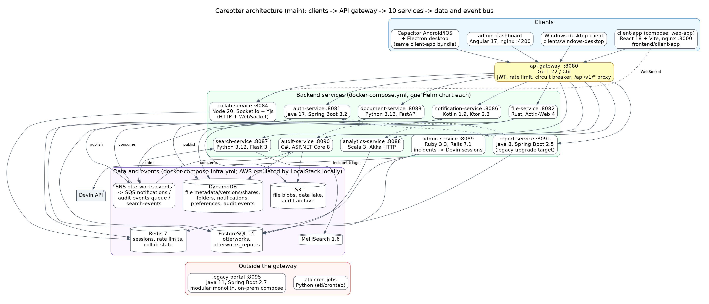

# Careotter

Careotter is a patient records management platform for doctor offices — a collaborative system for storing, editing, and sharing patient charts and clinical documents. Careotter is a fictional software company that has helped medical practices manage patient records for 20 years. The application is built as a polyglot microservices system to demonstrate a realistic enterprise technology stack.

## Prerequisites

- [Docker](https://docs.docker.com/get-docker/) and [Docker Compose](https://docs.docker.com/compose/) v2+
- ~12 GB of available RAM (for running all infrastructure and services locally)
- GNU Make (optional, for shorthand commands)
- Runs on both x86_64 and Apple Silicon (ARM64) — no Rosetta required

Individual service development may also require the language toolchains listed in the [Services](#services) table below.

## Quick Start (Local Development)

```bash
# Start infrastructure (Postgres, Redis, LocalStack, MeiliSearch, observability stack)
make infra-up

# Start all application services (builds images on first run)
make up

# Open the app
open http://localhost:3000        # Web App (React / Vite)
open http://localhost:4200        # Admin Dashboard (Angular)
```

Or without Make:

```bash
docker compose -f docker-compose.infra.yml up -d
docker compose -f docker-compose.infra.yml -f docker-compose.yml up -d --build
```

On first run, `scripts/init-db.sql` creates the required Postgres databases and `scripts/localstack-init.sh` provisions S3 buckets, SQS queues, SNS topics, and DynamoDB tables in LocalStack automatically.

To stop everything:

```bash
make down
```

## Services

| Service | Language | Framework | Port | Description |
|---------|----------|-----------|------|-------------|
| API Gateway | Go 1.22 | Chi | 8080 | Request routing, rate limiting, JWT validation |
| Auth Service | Java 17 | Spring Boot 3 | 8081 | Authentication, authorization, user management |
| File Service | Rust (stable) | Actix-Web 4 | 8082 | File upload/download, S3 integration, versioning |
| Document Service | Python 3.12 | FastAPI | 8083 | Document CRUD, version history, snapshots |
| Collaboration Service | Node.js 20 | Socket.io | 8084 (HTTP + WebSocket) | Real-time collaborative editing (CRDT via Yjs) |
| Notification Service | Kotlin 1.9 | Ktor 2.3 | 8086 | Event-driven notifications (email, in-app, webhook) |
| Search Service | Python 3.12 | Flask 3.0 | 8087 | Full-text search via MeiliSearch |
| Analytics Service | Scala 3.4 | Akka HTTP | 8088 | Usage analytics, data aggregation |
| Admin Service | Ruby 3.3 | Rails 7.1 | 8089 | Admin dashboard backend, incidents and Devin triage sessions |
| Audit Service | C# 12 | ASP.NET 8 | 8090 | Immutable audit trail, compliance |
| Report Service *(legacy)* | Java 8 | Spring Boot 2.5 | 8091 | PDF/CSV/Excel report generation (tech-debt: upgrade target Java 17+, Spring Boot 3.2+) |

> **Note:** The Report Service intentionally uses outdated dependencies (Java 8, Spring Boot 2.5, JUnit 4, javax.\*) and is a candidate for a framework-upgrade exercise. See `services/report-service/pom.xml` for details.

## Frontend Applications

| App | Framework | Port | Description |
|-----|-----------|------|-------------|
| Web App | React 18 / Vite SPA | 3000 | Main user-facing application (served by nginx in production) |
| Admin Dashboard | Angular 17 | 4200 | Administrative interface |
| Mobile (Android/iOS) | Capacitor | — | Native shells wrapping the Web App SPA; see [`frontend/client-app`](frontend/client-app/) |
| Desktop | Electron (`frontend/client-app/desktop`) | — | Desktop shell for the same SPA |
| Windows Desktop | WPF, .NET Framework 4.8 | — | Native Windows client in [`clients/windows-desktop`](clients/windows-desktop/) |

### Standalone

| App | Stack | Port | Description |
|-----|-------|------|-------------|
| Legacy Portal *(legacy)* | Java 11 / Spring Boot 2.7 | 8095 | On-prem modular monolith (announcements, preferences, feedback) used for rehost and decomposition exercises; not behind the gateway and not in `docker-compose.yml`. See [`services/legacy-portal`](services/legacy-portal/README.md). |

## Architecture

[](docs/diagrams/architecture.svg)

Clients call the Go **API gateway** (`:8080`), which checks the JWT and proxies `/api/v1/*` to ten backend services; the editor also holds a WebSocket to collab-service. Services keep relational data in PostgreSQL (`otterworks` and `otterworks_reports`), sessions and collab state in Redis, search indexes in MeiliSearch, and file blobs, metadata, notifications and audit events in S3 and DynamoDB. File and document changes go out on the `otterworks-events` SNS topic to SQS queues read by notification, audit and search. `legacy-portal` runs on its own, and `etl/` runs cron batch jobs.

The diagram is generated from [`docs/diagrams/architecture.dot`](docs/diagrams/architecture.dot) (Graphviz; run `docs/diagrams/render.sh` after editing). See [ARCHITECTURE.md](ARCHITECTURE.md) for routing, data, events, deployment and repository layout, [docs/flows.md](docs/flows.md) for request flows, and [demo-platform/docs/architecture.md](demo-platform/docs/architecture.md) for the multi-tenant demo platform.

## Infrastructure

### AWS Resources (App-Specific)
Managed via Terraform in `infrastructure/terraform/`:
- S3 (file storage, data lake, static assets)
- RDS PostgreSQL
- ElastiCache Redis
- DynamoDB (file metadata, audit events, notifications)
- SQS/SNS (event bus)
- MeiliSearch (full-text search)
- Cognito (identity federation)
- IRSA roles and CloudWatch monitoring

The VPC, EKS cluster and ECR repositories are in `platform/terraform/`.

### Kubernetes
- Helm charts per service in `infrastructure/helm/`
- Base namespace resources (ResourceQuota, LimitRange) in `infrastructure/k8s/`
- Deploys to the EKS cluster from `platform/terraform/`; per-attendee demo tenants are run by [`demo-platform/`](demo-platform/README.md)

### Deploy to AWS

```bash
# Initialize and apply Terraform
make tf-init
make tf-apply          # uses environments/dev.tfvars

# Deploy services to EKS
make deploy-dev
```

### Tear Down

```bash
make teardown-dev
```

## Observability

All observability services run locally via `docker-compose.infra.yml`.

| Tool | URL | Purpose |
|------|-----|---------|
| Grafana | http://localhost:3001 | Dashboards and metrics visualization (admin / careotter) |
| Prometheus | http://localhost:9090 | Metrics collection and alerting rules |
| Jaeger | http://localhost:16686 | Distributed tracing UI |
| MeiliSearch | http://localhost:7700 | Search engine dashboard |

- **Logging**: Structured JSON logs → Fluent Bit → CloudWatch (production) / stdout (local)
- **Metrics**: Prometheus scraping `/metrics` endpoints + Grafana dashboards in `observability/grafana/dashboards/`
- **Tracing**: OpenTelemetry SDK per service → OTel Collector → Jaeger
- **Alerting**: PrometheusRule definitions in `observability/prometheus/` → Alertmanager

## CI/CD

GitHub Actions workflows in `.github/workflows/`:

| Workflow | Trigger | Description |
|----------|---------|-------------|
| `ci.yml` | Push / PR to `main` | Lint, test, and build changed services (change-detection via path filters) |
| `docker-build.yml` | Push to `main` / tags | Build and push Docker images to ECR |
| `security-scan.yml` | Push / PR to `main`, weekly | SAST, dependency audit, and container scanning |
| `sast-auto-remediate.yml` | PR to `main` | Trivy and SonarCloud scans on human PRs; findings trigger a Devin auto-fix |

## Makefile Commands

Run `make help` to list all available commands. Key targets:

| Command | Description |
|---------|-------------|
| `make infra-up` | Start local infrastructure (Postgres, Redis, LocalStack, MeiliSearch, observability) |
| `make up` | Build and start all application services |
| `make down` | Stop all services and infrastructure |
| `make build` | Build all service Docker images |
| `make logs` | Tail logs for all services |
| `make dev-web` | Backend in Docker + client-app web dev server (HMR) on :3000 |
| `make dev-admin` | Backend in Docker + admin dashboard dev server (HMR) on :4200 |
| `make dev-android` | Backend in Docker + build, sync, and run the Android app (Capacitor) |
| `make dev-electron` | Backend in Docker + build and launch the Electron desktop app |
| `make test` | Run tests for all services |
| `make lint` | Lint all services |
| `make tf-plan` | Plan Terraform changes (dev) |
| `make deploy-dev` | Deploy all services to dev EKS |
| `make teardown-dev` | Tear down the dev environment |

Per-service build targets are also available (e.g., `make build-gateway`, `make build-auth`).

## Project Structure

```
careotter/
├── services/              # Gateway + 10 backend services (8 languages) + legacy-portal
│   ├── api-gateway/       #   Go / Chi
│   ├── auth-service/      #   Java / Spring Boot
│   ├── file-service/      #   Rust / Actix-Web
│   ├── document-service/  #   Python / FastAPI
│   ├── collab-service/    #   Node.js / Socket.io
│   ├── notification-service/ # Kotlin / Ktor
│   ├── search-service/    #   Python / Flask
│   ├── analytics-service/ #   Scala / Akka HTTP
│   ├── admin-service/     #   Ruby / Rails
│   ├── audit-service/     #   C# / ASP.NET
│   └── report-service/    #   Java 8 / Spring Boot 2.5 (legacy)
│   └── legacy-portal/     #   Java 11 / Spring Boot 2.7 standalone monolith
├── frontend/              # Web app (React/Vite) + Admin dashboard (Angular)
├── clients/windows-desktop/ # Native Windows client (WPF)
├── infrastructure/
│   ├── terraform/         #   App-specific AWS resources (S3, RDS, DynamoDB, etc.)
│   ├── helm/              #   Per-service Helm charts
│   └── k8s/               #   Base Kubernetes resources (namespace, quotas, limits)
├── shared/
│   ├── proto/             #   Protobuf / gRPC service definitions
│   ├── openapi/           #   OpenAPI specs per service
│   └── events/            #   Event schema definitions (JSON Schema)
├── observability/
│   ├── grafana/           #   Dashboards and provisioning
│   ├── prometheus/        #   Scrape config, alert rules, recording rules
│   ├── jaeger/            #   Jaeger deployment config
│   ├── otel/              #   OpenTelemetry Collector config
│   └── logging/           #   Fluent Bit config and parsers
├── security/
│   ├── policies/          #   Network policies (default-deny, DNS, namespace egress)
│   └── scanning/          #   Trivy container scanning config
├── etl/                   # Cron-driven Python batch jobs (scripts/, crontab, run.sh)
├── platform/terraform/    # VPC, EKS, ECR
├── demo-platform/         # Multi-tenant demo control plane (dashboard, runner, reaper, Helm, Terraform)
├── tests/api/             # Cross-service API flow tests
├── docs/                  # Flows, runbooks, labs, architecture diagrams
├── scripts/               # Deploy and teardown scripts
└── .github/workflows/     # CI/CD pipelines (ci, docker-build, security-scan, sast-auto-remediate)
```

## Contributing

### Getting Started

1. Fork the repository and create a feature branch from `main`.
2. Follow the [Quick Start](#quick-start-local-development) instructions to bring up the local environment.
3. Make your changes in the relevant service or module directory.

### Code Standards

- Each service follows the idiomatic conventions of its language (e.g., `go fmt`, `cargo clippy`, `ruff`, `eslint`).
- Run `make lint` before committing to catch issues early.
- Run `make test` to execute the full test suite.

### Commit Guidelines

- Use clear, descriptive commit messages.
- Keep commits focused — one logical change per commit.

### Pull Requests

1. Push your branch and open a PR against `main`.
2. Ensure CI passes (lint, test, build, security scan).
3. Include a concise description of **what** changed and **why**.
4. Link to any relevant issue or user story.

### Adding a New Service

1. Create a directory under `services/<service-name>/` with a `Dockerfile`.
2. Add the service to `docker-compose.yml` with the shared environment block (`x-common-env`).
3. Create a Helm chart in `infrastructure/helm/<service-name>/`.
4. Add OpenAPI and event schemas to `shared/`.
5. Update this README and `ARCHITECTURE.md`.

## License

Proprietary - Careotter Inc.
